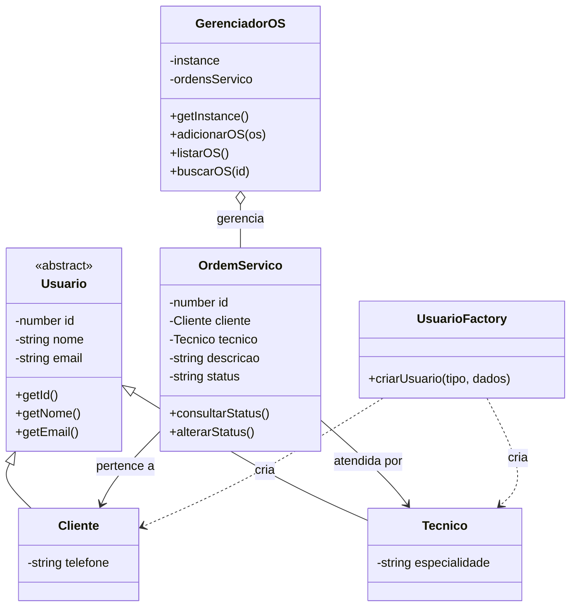

# TechOS Core — Sprint Express

## 1. Objetivo do Projeto

Desenvolver um sistema de gerenciamento de Ordens de Serviço para registrar consertos de equipamentos e acompanhar o atendimento.

## 2. Histórias de Usuário (INVEST)

### US01 — Abrir Ordem de Serviço

Como técnico, quero abrir uma Ordem de Serviço para registrar o conserto de um equipamento, para que o atendimento possa ser acompanhado.

**Critérios de aceitação:**
- CA01: A OS deve estar associada a um cliente válido.
- CA02: A descrição do problema deve ser obrigatória.
- CA03: O status inicial deve ser ABERTA.
- CA04: Cada OS deve possuir um identificador único.

### US02 — Consultar status do equipamento

Como cliente, quero consultar o status da minha Ordem de Serviço para acompanhar o andamento do conserto.

**Critérios de aceitação:**
- CA01: O sistema deve permitir buscar uma OS pelo identificador.
- CA02: Deve apresentar o status atual da OS.
- CA03: Se a OS não existir, deve informar que ela não foi encontrada.

## 3. Requisitos Não Funcionais (RNF)

### RNF01 — Segurança

O sistema deve validar os dados recebidos e evitar a execução de conteúdo não confiável. Se houver interface web, deve implementar proteção contra XSS e outras vulnerabilidades relevantes da OWASP.

### RNF02 — Desempenho

A criação de uma Ordem de Serviço deve responder em menos de 2 segundos em condições normais de uso.

## 4. Modelagem Orientada a Objetos

### Usuario (classe abstrata)

Atributos:
- id: number
- nome: string
- email: string

Métodos:
- getId()
- getNome()
- getEmail()

### Cliente (herda de Usuario)

Atributo:
- telefone: string

### Tecnico (herda de Usuario)

Atributo:
- especialidade: string

### OrdemServico

Atributos:
- id: number
- cliente: Cliente
- tecnico: Tecnico
- descricao: string
- status: string

Métodos:
- consultarStatus()
- alterarStatus()

### UsuarioFactory

Responsabilidade:
- Criar objetos Cliente ou Tecnico conforme o tipo solicitado.

### GerenciadorOS

Responsabilidade:
- Manter uma única instância do gerenciador.
- Adicionar, listar e buscar Ordens de Serviço.

## 5. Padrões Criacionais

- **Factory Method:** centraliza a criação de objetos Cliente e Tecnico.
- **Singleton:** mantém uma única instância do GerenciadorOS no processo da aplicação.

## 6. Tecnologias

## 7. Diagrama de Classes

- JavaScript (ES6 Modules)
- Node.js
- Git e GitHub
# techos-core-allyce-teixeira
Projeto TechOS Core — Sprint Express, com POO e padrões criacionais.
